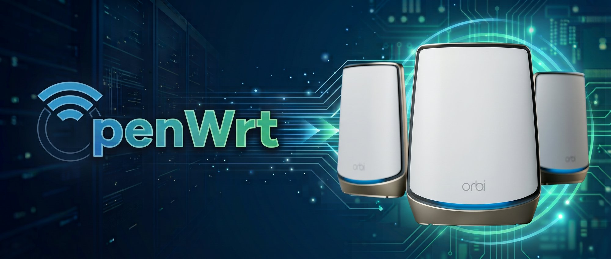

# Netgear Orbi RBR850 (AX6000) OpenWrt Installation & Configuration Guide



[](https://downloads.openwrt.org/snapshots/targets/qualcommax/ipq807x/)
[](https://github.com/jclehner/nmrpflash)
[](https://github.com/laserbirdx/netgear-rbs850-openwrt)
[](./LICENSE)

A complete, battle-tested guide for flashing and running mainline **OpenWrt** on the **Netgear Orbi RBR850** Wi-Fi 6 Tri-Band Mesh Router (`RBK852` / `RBK853` / `RBK854` kits) using `nmrpflash`—**without opening the case or soldering UART pins**.

Tested and verified on **macOS** (MacBook Air + USB Gigabit Ethernet adapter) across an entire RBK850 multi-node kit.

> 🔗 **Also Flashing Your RBS850 Satellites?**
> Check out our companion repository **[laserbirdx/netgear-rbs850-openwrt](https://github.com/laserbirdx/netgear-rbs850-openwrt)** for flashing the **Netgear Orbi RBS850 Satellite**, handling its default DHCP-client behavior on first boot, and optionally converting any RBS850 satellite into a full standalone OpenWrt router!

---

## 1. RBR850 (Router) vs. RBS850 (Satellite): Key Differences

While the **RBR850 Router** and **[RBS850 Satellite](https://github.com/laserbirdx/netgear-rbs850-openwrt)** look almost identical and share the exact same CPU, RAM, and 12-stream Wi-Fi 6 radios, they have important hardware and OpenWrt behavior differences:

| Feature | **Netgear RBR850 (Router)** *(This Repo)* | **[Netgear RBS850 (Satellite)](https://github.com/laserbirdx/netgear-rbs850-openwrt)** |
| :--- | :--- | :--- |
| **Board ID** | `U12H404T00_NETGEAR` | `U12H403T00_NETGEAR` |
| **SoC & RAM** | Qualcomm IPQ8074A (4x 2.2 GHz) + 1 GiB RAM | Qualcomm IPQ8074A (4x 2.2 GHz) + 1 GiB RAM |
| **Wi-Fi Radios** | Tri-Band AX6000 (QCN5024 + 2x QCN5054) | Tri-Band AX6000 (QCN5024 + 2x QCN5054) |
| **WAN Port** | **1x 2.5 GbE WAN** (`QCA8081` PHY on `uniphy1`) | **None** *(Can reassign `lan1` as 1 GbE WAN)* |
| **LAN Ports** | 4x 1 GbE LAN (`lan1`–`lan4` via `QCA8075`) | 4x 1 GbE LAN (`lan1`–`lan4` via `QCA8075`) |
| **NAND Flash** | 512 MiB (`W29N04GZ`, rootfs `@ 0x11c00000`) | 256 MiB / 512 MiB (rootfs `@ 0x3e80000`) |
| **Default OpenWrt Role** | **Router + DHCP Server** (`192.168.1.1/24`) | **Bridged DHCP Client** (`proto 'dhcp'` on `br-lan`) |
| **First-Boot Access** | Connect directly to LAN (`http://192.168.1.1`) | Connect to RBR850 LAN to receive a DHCP lease |

> 💡 **Pro Tip:** Because the [RBS850 Satellite](https://github.com/laserbirdx/netgear-rbs850-openwrt) does not run a DHCP server on first boot, **always flash and set up your RBR850 Router first!** Once your RBR850 is running OpenWrt at `192.168.1.1`, you can plug your freshly flashed RBS850 satellites into the RBR850's LAN ports so they automatically receive `192.168.1.x` IP addresses.

---

## 2. Detailed Hardware Specifications (RBR850)

| Component | Specification |
| :--- | :--- |
| **Model** | Netgear Orbi RBR850 (Router) |
| **Board ID** | `U12H404T00_NETGEAR` |
| **OpenWrt Target** | `qualcommax/ipq807x` (`aarch64_cortex-a53`) |
| **SoC** | Qualcomm IPQ8074A (Quad-Core ARM Cortex-A53 @ 2.2 GHz) |
| **RAM** | 1 GiB DDR4 (2x Samsung `4A4G165WE-BCRC`) |
| **Flash** | 512 MiB NAND (Winbond `W29N04GZ`) |
| **Wi-Fi 2.4 GHz** | Qualcomm QCN5024 4x4:4 802.11b/g/n/ax (`ath11k`, BDF `Netgear-RBK850`) |
| **Wi-Fi 5 GHz Low** | Qualcomm QCN5054 4x4:4 802.11a/n/ac/ax (Channels 36–64, 5180–5320 MHz) |
| **Wi-Fi 5 GHz High** | Qualcomm QCN5054 4x4:4 802.11a/n/ac/ax (Channels 100–140, 5500–5700 MHz) |
| **WAN Port** | 1x 2.5 GbE RJ45 (Qualcomm QCA8081 PHY) |
| **LAN Ports** | 4x 1 GbE RJ45 (Qualcomm QCA8075 PHY via `qca-ppe` / `qca-edma` DSA) |
| **Serial / UART** | 3.3V TTL `115200-8-N-1` (`Bottom <- RX, TX, GND, 3.3V (do not connect) -> Top`) |

---

## 3. Firmware Downloads

Official support was merged into OpenWrt mainline via [PR #24906](https://github.com/openwrt/openwrt/pull/24906).

* **Initial Installation Image (`factory.chk` for `nmrpflash`):**
  [`openwrt-qualcommax-ipq807x-netgear_rbr850-squashfs-factory.chk`](https://downloads.openwrt.org/snapshots/targets/qualcommax/ipq807x/openwrt-qualcommax-ipq807x-netgear_rbr850-squashfs-factory.chk)
* **Upgrade Image (`sysupgrade.bin` for upgrading from within OpenWrt):**
  [`openwrt-qualcommax-ipq807x-netgear_rbr850-squashfs-sysupgrade.bin`](https://downloads.openwrt.org/snapshots/targets/qualcommax/ipq807x/openwrt-qualcommax-ipq807x-netgear_rbr850-squashfs-sysupgrade.bin)
* **OpenWrt Firmware Selector (Custom Builds with Pre-Installed LuCI):**
  [https://firmware-selector.openwrt.org/?version=SNAPSHOT&target=qualcommax%2Fipq807x&id=netgear_rbr850](https://firmware-selector.openwrt.org/?version=SNAPSHOT&target=qualcommax%2Fipq807x&id=netgear_rbr850)

---

## 4. Step-by-Step Flashing Instructions (Verified on macOS & Linux)

Netgear's stock bootloader (`bootipq`) enforces cryptographic signature verification on firmware images. However, the OpenWrt `factory.chk` image embeds a custom U-Boot script (`netgear_rbx750_850.bootscript`) that runs automatically during NMRP recovery flashing, writing the UBI image to NAND and updating `bootcmd` to boot unsigned OpenWrt images.

### Prerequisites
1. Install **[nmrpflash](https://github.com/jclehner/nmrpflash)** (on macOS, download the macOS binary or install via Homebrew `brew install nmrpflash`).
2. Download [`openwrt-qualcommax-ipq807x-netgear_rbr850-squashfs-factory.chk`](https://downloads.openwrt.org/snapshots/targets/qualcommax/ipq807x/openwrt-qualcommax-ipq807x-netgear_rbr850-squashfs-factory.chk).
3. Connect your Mac/PC via a Gigabit Ethernet adapter to **any of the 4 Gigabit LAN ports** on the RBR850 (do **not** use the yellow 2.5G WAN port).

### Flashing Procedure
1. **Power off** (unplug) the RBR850.
2. List your local network interfaces to find your USB Ethernet adapter name (e.g., `en10` on macOS, or `eth0` on Linux):
   ```bash
   ./nmrpflash -L
   ```
3. Start `nmrpflash` waiting for the router:
   ```bash
   sudo ./nmrpflash -i en10 -f openwrt-qualcommax-ipq807x-netgear_rbr850-squashfs-factory.chk
   ```
4. **Plug in the power cable** on the RBR850.
5. Watch the terminal output. Below is the exact output from a successful flash on **macOS**:
   ```text
   ok-Air Downloads % sudo ./nmrpflash -i en10 -f openwrt-qualcommax-ipq807x-netgear_rbr850-squashfs-factory.chk
   Advertising NMRP server on en10 ... - 
   Received configuration request from 08:36:c9:e6:cf:94.
   Sending configuration: 10.164.183.253/24.
   Received upload request: filename 'firmware'.
   Uploading openwrt-qualcommax-ipq807x-netgear_rbr850-squashfs-factory.chk ...  OK (14419405 b)
   Waiting for remote to respond.
   Received upload request: filename 'firmware'.
   Uploading openwrt-qualcommax-ipq807x-netgear_rbr850-squashfs-factory.chk ... Connection closed by remote while waiting for ACK(0).
   Received late close request.
   ```
   > **Note:** Seeing `Connection closed by remote while waiting for ACK(0)` followed by `Received late close request` on a second upload attempt is **completely normal and indicates a successful flash**! During `Waiting for remote to respond`, the router is erasing and writing the NAND partition (`nand erase.part fs && nand write`) and saving the new U-Boot environment. Once finished, it sends the NMRP close request.

6. Wait until the rear Power LED **blinks amber/orange** (or wait ~30 seconds after `Received late close request`), then **unplug the power cord and plug it back in**.
7. Wait ~40 seconds for OpenWrt to boot. Your computer will receive a `192.168.1.x` IP address via DHCP, and the router will be reachable at **`192.168.1.1`**:
   ```bash
   ssh root@192.168.1.1
   ```

---

## 5. Installing the LuCI Web Interface (`http://192.168.1.1`)

Because OpenWrt `SNAPSHOT` builds do not include the `luci` web interface by default, you have two ways to install it:

### Option A: Router Has Internet on WAN Port
Connect your upstream modem/router to the 2.5G WAN port and run via SSH:
```bash
ssh root@192.168.1.1 "apk update && apk add luci"
```

### Option B: Offline Router on macOS (Using Your Mac's Wi-Fi via SSH Reverse Tunnel)
When connected to the offline RBR850 via USB Ethernet (`en10`) on macOS, macOS may prioritize the Ethernet default route over Wi-Fi (`en0`). Our included script resolves `downloads.openwrt.org` explicitly over your Mac's Wi-Fi interface (`en0`) and tunnels `apk` requests over SSH into the router:
```bash
./scripts/install-luci-offline.sh 192.168.1.1 en0
```
Once finished, open **[http://192.168.1.1](http://192.168.1.1)** in your browser (`root` / no password).

---

## 6. Hardware Architecture & Performance Notes (EDMA / PPE / Offloading)

* **Ethernet Switching (`qca-edma` & `qca-ppe`):** Mainline OpenWrt (Kernel 6.18+) uses the built-in kernel `qca-edma` (`3ab00000.edma`) and `qca-ppe` (`3a000000.ppe` Packet Processing Engine) DSA drivers to manage both the 4x 1GbE QCA8075 switch ports (`lan1`–`lan4`) and the 2.5GbE QCA8081 `wan` port.
* **NAT / Routing Offloading:** Official OpenWrt builds do not bundle proprietary Qualcomm QSDK `qca-nss-drv` firmware. For multi-gigabit NAT throughput with minimal CPU usage, enable **Software Flow Offloading** in LuCI under **Network → Firewall → Routing/NAT Offloading** (or via CLI):
  ```bash
  uci set firewall.@defaults[0].flow_offloading='1'
  uci commit firewall
  /etc/init.d/firewall restart
  ```

---

## 7. Reverting to Netgear Stock Firmware *(Not Tested)*

> ⚠️ **UNVERIFIED / NOT TESTED:** Reverting from OpenWrt back to Netgear stock firmware has **NOT been personally tested** by us. The steps below are taken from the upstream OpenWrt PR commit notes—proceed at your own risk!
>
> ⚠️ **CRITICAL WARNING:** Before flashing stock Netgear firmware, you **MUST** restore the original `bootcmd` (`bootipq`) inside OpenWrt. If you flash stock firmware without reverting `bootcmd`, the device will fail to boot and get stuck in a recovery loop (flashing red power LED).

1. While still running OpenWrt, SSH into the router and restore `bootipq`:
   ```bash
   fw_setenv bootcmd bootipq
   ```
2. Start `nmrpflash` on your computer with the official Netgear stock `.img` firmware file:
   ```bash
   sudo ./nmrpflash -i en10 -f RBR850-V7.2.6.31.img
   ```
3. Reboot/power-cycle the RBR850 and wait for `nmrpflash` to complete.

---

## Related Projects & References
* Companion Satellite Guide: **[laserbirdx/netgear-rbs850-openwrt](https://github.com/laserbirdx/netgear-rbs850-openwrt)** (Netgear Orbi RBS850 Satellite OpenWrt Guide & Router Conversion)
* Device support authored by **Michael Lotz** (`@mmlr`) and adapted/merged by **Piotr Szczepanik** (`@piter75`) in [openwrt/openwrt#24906](https://github.com/openwrt/openwrt/pull/24906).
* [OpenWrt Forum Thread: Anyone working on Netgear RBR850?](https://forum.openwrt.org/t/anyone-working-on-netgear-rbr850/127999)
* [TechInfoDepot Wiki: Netgear Orbi Router (RBR850)](https://techinfodepot.shoutwiki.com/wiki/Netgear_Orbi_Router_(RBR850))

## License
Released under the [MIT License](./LICENSE).
